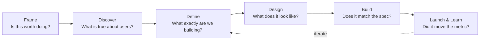
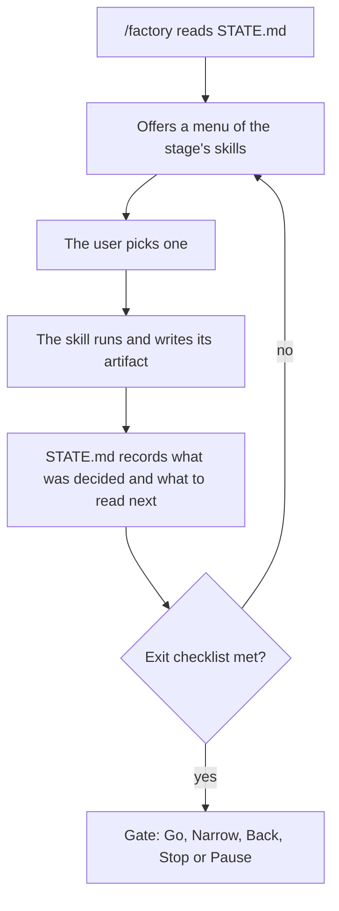
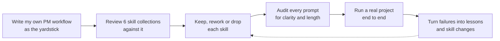

# PM Factory: An AI-Native Product Workflow

PM Factory is a set of 31 Claude Code skills that take a product from a vague idea to a shipped, measured release. The agent does the heavy lifting at every step: research, specs, prototypes, code, tests and reviews. A person makes every call that matters. The rest of this page shows how that split works, what it has shipped, and how it was built.

## How it works
Work moves through six stages. Each stage asks one question, writes its answer down, and ends at a gate where a person decides what happens next.



Inside every stage, the same loop runs.



A few rules hold the whole thing together.
- **The user owns every decision.** The router never runs a skill on its own, and every gate decision is recorded with a date and an owner.
- **STATE.md is the handoff.** Each stage names the exact files the next one reads, so the agent works from decisions, not from rereading everything.
- **AI behavior gets evals, not vibes.** Anything an AI judges is scored against real labeled cases, with a holdout set the prompts are never tuned on.
- **The builder never grades its own work.** Code is reviewed by a second model, high-risk changes by a person, and the finished product by an independent agent that tries to break every requirement.
- **Failures ratchet.** Every real mistake becomes a one-line lesson, and lessons that recur get promoted into the skills themselves.

The router supports four modes: a new product, a revamp, a new feature, and a fix. Each one takes a different path through the stages.

## The skills
Each stage is a small set of skills. The router offers them as a menu, and the user picks.

| Stage | Skills |
|---|---|
| Frame | interview-me, idea-refine, landscape-and-sizing |
| Discover | interview, feedback-mining, segments-personas, opportunity-solution-tree, assumptions-to-experiment |
| Define | define-intake, spec, red-team, tasks |
| Design | design-brief, prototype, design-critique, design-polish |
| Build | build-setup, test-plan, build-slice, debug, review-pr, spec-check, ship-packet |
| Launch & Learn | launch-plan, measure-setup, learn-readout, retro |
| Any stage | stakeholder-update, decision-memo, roadmap |

Open `map/factory-map.html` in a browser for an interactive map of every stage, skill, input and output.

## Proof: a real product built with it
Rules only matter if they hold up on a real product. [ADK: Automated Voice-of-Customer Analysis](https://github.com/BishopSlice/adk-voc) went through every stage. It reads every new issue in Google's Agent Development Kit repos each week and publishes a cited, independently checked brief of what is hurting developers. The factory caught real problems along the way.
- Discover tested the riskiest assumptions before any code. AI sorting agreed with hand labels on 97% of real issues.
- Build ran evals with a fresh holdout and scored 9 of 9 on issues the classifier never saw.
- The independent spec check found two leaks, personal data and exploit wording, and both were fixed before launch.
- A timer test found that a new content filter held a normal week. It was fixed and became a lesson.

## How it was built
The factory went through the same discipline it enforces. I reviewed six open source PM and agent skill collections, kept what earned its place, and rewrote the rest to fit one workflow. Then I ran a real product through it and let every failure change the factory.



The sources are credited in [CREDITS.md](CREDITS.md). The skills are original writing.

## Use it
Requires [Claude Code](https://claude.com/claude-code).
```
git clone https://github.com/BishopSlice/pm-factory.git
cd pm-factory
claude
/factory new my-project
```
The router asks for a mode, then offers the first stage's skills. Each project lives in `projects/<name>/`, which is kept out of git.
